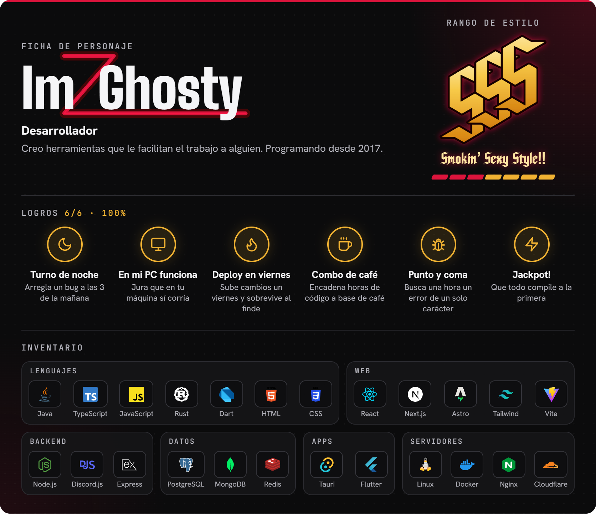

Programo desde 2017 con una idea fija: que a alguien le cueste menos hacer su trabajo. Casi todo es para clientes y comunidades, así que el código se queda privado; lo que hago lo cuenta el [portafolio](https://imzghosty.pages.dev).

### ¿Player 2? Pulsa start

Para trabajo o proyectos, escríbeme por **[Discord](https://discord.gg/9q2NhvP6vy)**. También estoy en [YouTube](https://youtube.com/@imzghosty) · [Instagram](https://www.instagram.com/_imzghosty_/) · [TikTok](https://tiktok.com/@imzghosty) · [Twitch](https://twitch.tv/imzghosty).

Logos y fuentes de la ficha: [créditos](assets/CREDITS.txt).
