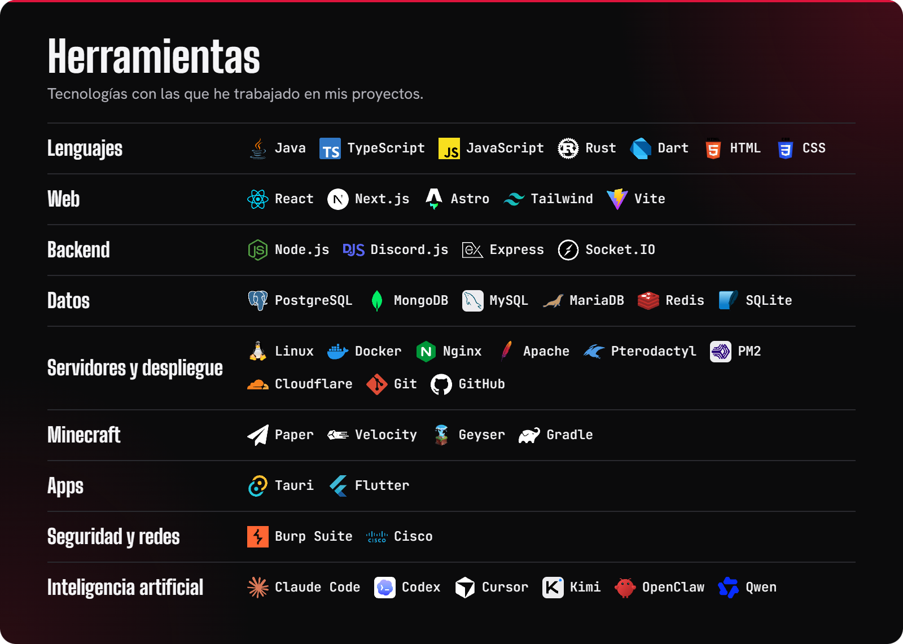

## Hola, soy ImZGhosty

Me apasiona la programación desde que escribí mis primeras líneas de HTML en el bloc de notas del colegio. Desde 2017 creo proyectos propios y para otros con una idea en común: que le faciliten el trabajo a alguien. Llevo más de 35 proyectos construidos.

Entiendo cómo funcionan los sistemas por dentro y me apoyo en herramientas de IA como Claude Code y Codex como referencia y para avanzar más rápido. Lo que entrego lo reviso y lo pruebo, y sigo aprendiendo con cada proyecto.

### Lo que he hecho

- **Desarrollo web:** sitios rápidos y bilingües, tarjetas de presentación y paneles de administración.
- **Automatización y bots:** asistentes que atienden soporte, moderan y organizan comunidades en línea.
- **Servidores de videojuegos:** servidores de Minecraft con sistemas propios, sobre paneles como Pterodactyl.
- **Servidores Linux:** máquinas en OVH, ReliableSite y Sparked Host, con Nginx, Apache y Docker.
- **Aplicaciones:** programas de escritorio y móvil para el día a día de un negocio.
- **Backend y datos:** APIs, bases de datos y servicios que comparten información en tiempo real.
- **Ciberseguridad y redes:** pruebas de seguridad en aplicaciones web con Burp Suite y redes Cisco.

### Dónde encontrarme

**[Portafolio](https://imzghosty.pages.dev)** · [Discord](https://discord.gg/9q2NhvP6vy) · [YouTube](https://youtube.com/@imzghosty) · [Instagram](https://www.instagram.com/_imzghosty_/) · [TikTok](https://tiktok.com/@imzghosty) · [Twitch](https://twitch.tv/imzghosty)

¿Tienes una oferta de trabajo o un proyecto? Escríbeme por Discord; mi correo estará disponible muy pronto.

Los logos de las herramientas pertenecen a sus dueños; fuentes y licencias en [assets/CREDITS.txt](assets/CREDITS.txt).
