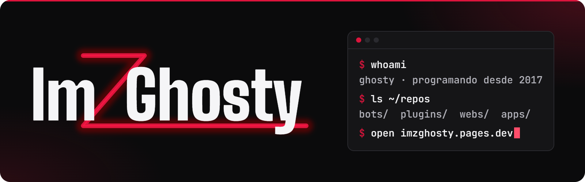

<a href="https://imzghosty.pages.dev"></a>

Soy Ghosty. Programo desde 2017, casi siempre con la misma idea: que a alguien le cueste menos hacer su trabajo. Si vienes del [portafolio](https://imzghosty.pages.dev), ya viste el escaparate; esto es el taller.

### ¿Por qué hay tan pocos repos públicos?

Porque casi todo lo que programo es para clientes o comunidades, y ese código se queda privado. Esto es lo que hay detrás:

| Qué | Para qué | Con qué |
|---|---|---|
| **Bots de Discord** | Soporte, moderación y organización de comunidades | TypeScript, JavaScript, Discord.js |
| **Plugins de Minecraft** | Sistemas propios para servidores | Java, Paper, Velocity, Gradle |
| **Webs** | Sitios rápidos y bilingües, paneles de administración | Astro, React, Next.js, Tailwind |
| **Apps** | Escritorio y celular para el día a día de un negocio | Tauri, Flutter |
| **Backend** | APIs y datos en tiempo real | Node.js, Express, Socket.IO, PostgreSQL, MongoDB, Redis |

Y para que todo eso corra: Linux, Docker, Nginx, Pterodactyl, PM2 y Cloudflare.

### Lo que sí puedes probar

**[TaskMaster](https://github.com/Im-ZGhosty/taskmaster-releases)**: app de escritorio para Windows para organizar tareas y proyectos. Funciona sin conexión y se usa casi entera con el teclado. [Descargar la última versión](https://github.com/Im-ZGhosty/taskmaster-releases/releases/latest).

### Changelog

```text
2026  primeros clientes · desarrollo asistido por IA
2025  desarrollo web y de sistemas, de lleno
2022  una plataforma con cientos de usuarios conectados a la vez
2021  mi primera herramienta usada por decenas de comunidades
2017  primeros proyectos por mi cuenta
 ...  primeras líneas de HTML, en el bloc de notas del colegio
```

### Cómo trabajo

- Me gusta entender cómo funciona un sistema por dentro antes de construir encima.
- Uso IA (Claude Code y Codex) como copiloto: me da referencias y velocidad, pero lo que entrego lo reviso y lo pruebo yo.
- Sigo aprendiendo con cada proyecto.

### Hablemos

Para trabajo o proyectos, escríbeme por **[Discord](https://discord.gg/9q2NhvP6vy)** (el correo llega pronto). También estoy en [YouTube](https://youtube.com/@imzghosty) · [Instagram](https://www.instagram.com/_imzghosty_/) · [TikTok](https://tiktok.com/@imzghosty) · [Twitch](https://twitch.tv/imzghosty).

<sub>¿Encontraste un bug en TaskMaster? Enciende la batiseñal: [abre un issue](https://github.com/Im-ZGhosty/taskmaster-releases/issues).</sub>
